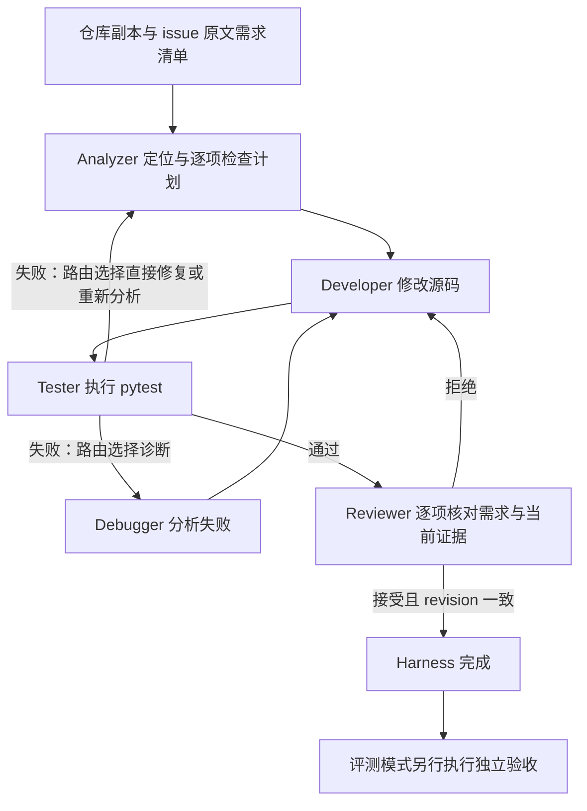

# CodeRoute 使用与交付说明

CodeRoute 是修复小型 Python 仓库的命令行工具。你提供仓库和问题描述，工具在副本里修改代码，执行 pytest，并生成补丁、审查与调用记录。主模型是 DeepSeek，Hybrid 路由额外使用 OpenRouter Qwen；无需部署本地模型，没有接入 Jev。

## 安装与无费用演示

要求 Python 3.9+、Git 在 PATH 中，以及 pytest 7–8。Windows PowerShell 在项目目录执行；下面显式使用虚拟环境解释器，无需修改脚本执行策略：

```powershell
python -m venv .venv
.\.venv\Scripts\python.exe -m pip install -e .
.\.venv\Scripts\python.exe main.py --repo examples/demo_repo --issue-file examples/issue.txt --mode mock --workflow hybrid --config configs/release.json
.\.venv\Scripts\python.exe -m pytest -q
```

如果现有 Python 已有依赖，也可直接使用 `python` 替代虚拟环境解释器。mock 只支持示例仓库：调用是脚本模拟，文件修改与 pytest 是真实的，不能用来证明真实模型能力。预期 CLI 返回 `status: succeeded`，并给出独立 `runs/` 目录；源示例仍保留原缺陷。

## 配置与真实运行

首次使用时在项目根目录创建 `.env`，只填需要的密钥（已有文件直接编辑，不覆盖）：

```dotenv
DEEPSEEK_API_KEY=你的主模型密钥
OPENROUTER_API_KEY=你的OpenRouter密钥
```

`.env.example` 列出了其他可选环境变量；已有进程环境变量优先于 `.env`，`CODEROUTE_MODEL` 等非空覆盖项优先于 JSON 配置。JSON 中 `api_key_env` 是变量名，不是密钥值。实际配置会写入评测 `experiment.json`，便于检查覆盖后的结果。

```powershell
python main.py --repo examples/demo_repo --issue-file examples/issue.txt --mode live --workflow hybrid --config configs/release.json
```

真实运行会产生 API 费用。自己的项目可替换 `--repo` 路径和 `--issue-file`（UTF-8 文本）。被修复项目的依赖需事先装好，测试需能由同一个 Python 的 `python -m pytest` 执行。

| 配置 | 用途 |
|---|---|
| `configs/release.json` | 第一版主线：原生调用、有界纠正、开发交接、上下文刷新；不启用生成测试；固定评测使用此配置 |
| `configs/default.json` | 原常规预算，思考模式遵循提供商默认值 |
| `configs/nonthinking.example.json` | 原预算，显式关闭主模型思考模式 |
| `configs/acceptance.json` | 收尾功能验收：非思考、8192 输出 token、12 角色回合、64 次总调用上限 |
| `configs/reliable-tools.json` | 补充测试实验配置：函数调用、一次协议纠正、批量编辑、开发交接、Reviewer 副本生成测试；不作为第一版默认流程 |

验收配置用于功能验证，不代表已证明它比其他配置更好。新版角色主模型空白、格式或多动作响应允许合计一次纠正，仍计入原预算；截断响应停止。轻量路由的错误与低置信度会在共享预算内升级主模型。启用补充验证时，生成测试失败也可能代表测试写错，需要核对需求，不能盲目改正确代码。详见 [改造记录](archive/STRUCTURED_REVIEW.md)。

## 运行结构



上图是常见路径；动态路由也可在允许的状态中直接选择 Developer。`fixed` 固定分支，`llm` 每步模型路由，`dynamic` 规则优先＋主模型路由，`hybrid` 规则优先＋轻量模型＋主模型回退。只有 Developer 可通过编辑工具改已有源码；Tester 不调用模型。

原文按句子、分号和换行形成编号，Analyzer 提交每条的检查计划，Developer 获得完整清单，Reviewer 必须逐条标记 `met/unmet/uncertain` 并给出依据。接受时全部条目必须为 met，所引用片段必须存在于当前 Python 文件中。机械检查不能证明引用在逻辑上足以支撑结论；仍需模型审查和独立测试。

## 查看产物与判断完成

每次运行创建新目录，终端输出其绝对路径：

- `final.diff`：可人工审阅的补丁，不自动应用回原仓库。
- `final_state.json`：最终状态、需求计划、审查结果、源码 revision。
- `trajectory.json/jsonl`：角色、路由、工具与模型响应记录。
- `metrics.json`：调用、token、预算与响应错误指标。
- `pytest-*.log/xml`：每次真实测试的输出。

多角色 `succeeded` 只表示当前源码通过公开测试和审查。评测还要求独立验收通过、原案例未变，才把 `results.json` 的 `success` 记为 true。`single` 模式只有测试门禁，没有五角色审查机制。

```powershell
# 不调用模型，校验流式案例原始缺陷与参考修复
python evaluate.py --benchmarks benchmarks_streaming --config configs/acceptance.json

# 读取既有评测目录中的真实纠错证据，不产生 API 调用
python scripts/summarize_recovery.py runs/你的评测目录
```

不要把“公开测试恢复”当作“最终验收成功”。当前结果以 [固定版本交付评测](RELEASE_EVALUATION.md) 为准；[先前验收记录](archive/FINAL_ACCEPTANCE.md) 保留的是旧版本结果。

## 统一的 14 案例评测

清单 `configs/release-suite.json` 包含 10 个基础案例、3 个跨文件案例和 1 个流式案例。转账案例采用明确异常类型的 v2；旧版仍保留在原目录。清单路径相对于清单文件解析。程序默认只校验案例，不调用模型；显式 `--live` 才启动真实修复。

```powershell
python evaluate.py --suite configs/release-suite.json --config configs/release.json
python evaluate.py --suite configs/release-suite.json --config configs/release.json --live --workflows hybrid --repeats 1 --max-runs 14
```

第二条命令会产生 14 次真实修复任务的 API 用量。每次最多 64 次模型调用（包括角色和两级模型路由）、16 个角色步骤、12 个单角色回合、600 秒；单次输出上限 8192 token，轻量输出上限 512。失败不会自动重跑。批次保存执行源码指纹、实际配置、案例路径/指纹及逐例结果。

release 配置在角色对话超过上下文上限的 80% 时，从当前代码重新组装上下文，保留进入角色时的测试/审查反馈、最近动作摘要和剩余回合；不重置调用预算。新上下文本身过大仍停止。它减少重复对话占用，不保证语义上保留每条旧信息。

## 当前边界

只支持依赖就绪的小型、可信 Python 仓库；pytest 会执行被修复仓库的代码，工作区副本不是操作系统安全沙箱。编辑工具不改测试/配置，不创建新文件，也不安装被修复项目的依赖。预算耗尽、无效 API 响应和语义漏项仍可能失败；不会保证任意 issue 都能修好。模型自报置信度未校准，自建案例不代表 SWE-bench 或生产项目成功率。

继续开发时，核心入口在 `src/coderoute/multi_harness.py`，原文需求校验在 `requirements.py`，角色协议在 `agents/roles.py`，路由在 `routers/`，独立验收在 `evaluation.py`。旧运行依赖旧源码，不要在代码已改变后使用恢复脚本续跑旧批次。
