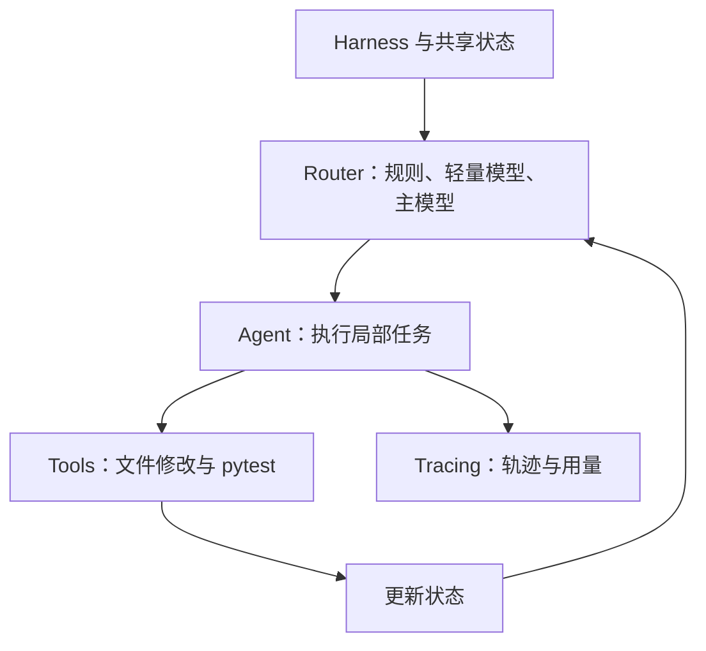

# CodeRoute 项目详解

基于自适应 Harness 的多智能体代码修复系统

版本 0.1.0 · 第一版交付说明 · 2026-09-29

本说明介绍当前项目的设计、实现、运行方式和实际结果。读者可以先了解整体流程，再结合目录和接口阅读代码。项目面向小型 Python 仓库，使用真实模型 API、文件操作和 pytest 构成修复闭环。

## 01 项目概览与设计目标

CodeRoute 接收一个 Python 项目和一段 bug 描述，自动读取源码、定位问题、修改文件、运行测试，并根据执行反馈继续修复或进入审查。最终输出补丁、测试结果、角色轨迹和模型用量。它是一个命令行工程原型，适合展示 Agent Harness、多角色协作、动态路由与执行反馈的实现方式。

项目的重点是把“代码推理”和“运行控制”分开。分析问题、生成补丁和解释失败由模型承担；当前执行到哪里、下一步调用谁、允许使用什么工具、什么时候结束，由 Harness 与 Router 共同管理。这让角色职责和流程约束更加清楚，也便于检查每次失败发生在哪一层。

用户需要提供仓库路径和 issue 文本。被修复仓库使用 Python 与 pytest，依赖提前准备好。输出保存在新建的工作目录，原始仓库不自动回写。用户可以查看最终 diff，再决定是否将补丁应用到自己的代码。

| 项目项 | 当前实现 |
|---|---|
| 运行方式 | 本地 Python 命令行程序，远程模型 API |
| 协作角色 | Analyzer、Developer、Tester、Debugger、Reviewer |
| 主模型 | DeepSeek，当前配置模型名 deepseek-flash |
| 轻量路由 | OpenRouter 上的 qwen/qwen3-30b-a3b-instruct-2507 |
| 主要评测 | 固定版本 Hybrid，14 个自建任务各一次，成功 13 个 |
| 工程检查 | 124 项自动化测试通过 |

项目不需要本地部署模型，没有接入 Jev，不包含训练、强化学习或长期记忆。“自适应”指运行时根据状态改变角色路径，不表示系统能够自动训练控制器或改写自己的架构。

第一版已经具备完整的功能链路和可展示结果。复杂状态机仍可能漏修，审查也可能误判；目前定位是有明确边界的工程原型。

## 02 使用场景与输入输出

适合的任务通常具有三个特征：问题范围较小、相关文件能够在有限上下文中理解、测试可以由 pytest 在本地运行。例如配置解析、金额单位换算、缓存语义、分页边界、重试条件以及跨文件函数约定。

一次任务的输入不是只有源码。issue 应说明预期行为、当前异常和需要保留的接口约定。需求越明确，模型越容易区分“应该修复的缺陷”和“不能随意改变的现有行为”。如果验收要求某种异常类型，最好在描述中直接写明。

```text
输入
  repo: 一个依赖就绪的 Python 仓库
  issue: 缺陷描述与预期行为
  config: 模型、路由及预算配置

输出
  final.diff: 可检查的源码补丁
  final_state.json: 最终状态和审查结论
  trajectory.json / jsonl: 执行轨迹
  metrics.json: 调用、token、步骤和耗时
  pytest-*.log / xml: 测试日志及结构化结果
```

例如“发票输入为分，输出应为含税美元金额”不仅要求修正主函数，还要求保持税费辅助函数接收美元这一约定。只让某条公开测试通过，未必满足完整需求。

每次任务建立新的工作副本，修改和测试都在副本中进行。副本通过 Git index 保存初始状态，再据此生成 diff；输入目录不必已经是 Git 仓库，也不需要配置提交身份。

运行完成后应同时查看状态、测试和 diff。`succeeded` 在多角色任务中表示当前版本通过公开测试与审查；只有在评测模式下再通过独立验收，才计为评测成功。普通用户仓库不会自动获得一套外部标准答案测试。

当预算耗尽或遇到执行错误时，系统仍保留已有补丁与日志，方便人工诊断，但不把这些任务计为成功。

## 03 总体架构与模块关系

系统由五个相互配合的部分组成：Harness 管执行循环，State 保存事实，Router 选择角色，Agent 完成局部任务，Tool Layer 执行文件和测试操作。Tracing 与 Metrics 跟随整个过程，记录模型响应和真实执行结果。



流程从 CLI 开始。程序读取配置和 issue，选择对应工作流，由工厂函数构建主模型客户端、可选轻量客户端与 Router。Harness 创建工作副本和状态，在预算内不断完成“路由、执行、更新、检查”的循环。

角色不能直接把自己的一句“完成了”转换成全局成功。角色的 submit 只提交本地结果，Harness 还会校验结果结构、需求覆盖和当前验证状态。例如 Developer 提交修改说明后，下一步必须实际执行测试。

Router 与角色实现分开：相同的 Analyzer、Developer 等角色可以由不同策略调度，从而比较固定流程、全模型路由和分层路由。更换路由策略不需要重新实现工具或测试组件。

系统采用顺序调度：同一时刻执行选定角色。这里的多智能体是职责、上下文、权限和结果结构的划分，不是五个独立模型并行工作。四个推理角色可以复用同一个 DeepSeek 服务，Tester 则完全不调用模型。

核心模块主要使用 Python 标准库，便于阅读和调试。pytest 是运行测试的依赖；Git 用于保存工作副本的差异基线。PDF 文档生成工具不属于修复任务的运行依赖。

## 04 五个角色的职责和协作

Analyzer 负责理解 issue、查阅源码和测试，形成可执行的缺陷假设。输出包含 suspected_files、hypothesis、confidence 和 requirement_plan。它需要覆盖全部需求条目，不能只分析公开测试中已经暴露的问题，也不能直接改代码。

Developer 根据分析和反馈修改已有 Python 源码。它能看到分析计划、当前 diff、实际测试结果和审查反馈。即使 Router 从 Tester 直接返回 Developer，也能收到错误日志，不要求 Debugger 必然介入。输出 change_summary 只说明做了什么，不代表测试通过。

Tester 运行真实 pytest，提取通过数、失败数、错误数、日志和源码 revision。它不做复杂原因推理，也不调用模型。这样可以把测试事实与模型解释分开，避免把模型声称的结果当作已执行结果。

Debugger 解释失败原因。失败类型包括 incorrect_patch、incomplete_patch、wrong_localization、incorrect_hypothesis、regression、environment_error、test_problem 和 unknown。输出原因与后续建议，建议可以是 Developer 或 Analyzer；动态 Router 仍负责最终选择。

Reviewer 对照原始需求、当前代码、diff 和测试证据进行审查。结果包含 accepted、risk_level、reason、requirement_checks、recommended_next_agent 和 confidence。审查可以退回修改或重新分析，不能通过编辑工具自行改补丁。

| 角色 | 输入重点 | 可以执行的核心工作 |
|---|---|---|
| Analyzer | issue、源码、已有诊断 | 阅读、搜索、定位与检查计划 |
| Developer | 假设、源码、失败和审查反馈 | 精确替换、批量修改、查看 diff |
| Tester | 当前工作副本 | 运行 pytest、提取事实 |
| Debugger | 失败日志、代码、分析结论 | 分类原因、建议恢复方向 |
| Reviewer | 完整需求、补丁、测试与引用 | 接受或拒绝并说明证据 |

角色共享事实，但局部对话分别建立。新的角色获得按职责整理的状态，不需要继承此前所有模型对话。这可以减少无关内容传播，也让轨迹更容易解释。

## 05 共享状态与代码版本一致性

RepairState 是协作的中心。它记录 issue、source_repo、workspace、mode、revision、status、stop_reason、steps、modified_files、test_result、current_agent、analysis、debug_feedback、developer_result、review、review_revision 与 history。

其中 revision 是根据工作区内容计算的版本标识，不是模型随意填写的标签。每次编辑完成后，系统重新计算内容标识；如果发生变化，旧 test_result 和 review 会失效。测试结果和审查必须属于同一份当前代码，才能结束任务。

```text
版本 A -> pytest 通过 -> 审查通过
               |
         Developer 再次修改
               v
版本 B -> 旧测试和旧审查失效
       -> 必须重新测试与审查
```

这个设计解决了多轮修复中常见的一致性问题：一份补丁通过过测试，不代表后续修改后的补丁仍然正确。系统不能拿 A 的测试结果为 B 背书。

`verified()` 检查当前代码是否具有通过的测试结果；`accepted()` 进一步要求 Reviewer 接受，且审查 revision 与当前代码一致。即使 Router 请求 finish，Harness 也会再次检查这些条件。

任务还会记录角色历史和停止原因。运行状态可区分 succeeded、budget_exhausted、stalled 和 execution_error，便于判断是修复完成、预算不足、重复无进展还是执行异常。失败运行也会保存 final.diff 和最终状态。

共享状态保存经过结构校验的角色结果；模型的解释仍可能不正确。因此，状态一致性解决的是“这些证据是否对应同一份代码”，不能证明“这些证据是否足以说明逻辑正确”。后者需要测试、审查和独立验收共同判断。

## 06 动态路由与四种工作流

项目支持四种多角色工作流，并保留 single 作为早期单角色基线。它们共用状态、工具和验证约束，主要区别在于如何选择下一位角色。

| 工作流 | 决策方式 | 适合展示的内容 |
|---|---|---|
| fixed | 使用固定分支和诊断/审查建议 | 基础协作闭环 |
| llm | 每一步都请求主模型路由 | 全模型控制基线 |
| dynamic | 单一合法动作由规则处理，其余问主模型 | 规则与模型分工 |
| hybrid | 规则、轻量决策、主模型回退 | 三级运行时决策 |

RuleGate 先给出合法动作集合。尚未分析时只能 Analyzer；Developer 完成后必须 Tester；当前测试通过后通常进入 Reviewer。测试失败时，可以选择 Analyzer、Developer 或 Debugger。审查拒绝后，只能继续分析或修改。

固定工作流也具有失败分支，它并不意味着所有任务只执行四个角色。它的主要转移关系事先规定；动态工作流则会在允许的动作中根据运行状态选择恢复路径。

例如失败日志已明确指出某个条件判断错误，Router 可以直接选择 Developer。如果测试失败涉及多处状态变化，可以先选择 Debugger。如果当前假设明显不成立，则可以回到 Analyzer。模型选择仍然经过 RuleGate 校验，非法动作不会直接执行。

Router 获得的是有界状态摘要，包括 issue、假设、修改文件、测试状态和摘要、诊断建议、审查反馈、近期角色、当前步骤及 allowed_actions。它不会获得整个仓库的完整源码，以控制决策上下文大小。

因此，路由的任务是决定“下一步由谁处理”，而不是直接生成修复代码。角色负责实际分析与修改，Harness 保证调度结果落在允许的状态转换中。

## 07 Hybrid 的三级决策和模型接入

Hybrid 首先检查合法动作是否只有一个。如果是，规则直接决定，不调用路由模型。存在多个选择时，请求轻量模型返回 choice、confidence 和 reason。合法且达到阈值的结果直接采用；否则再请求主模型路由。

当前阈值为 0.65。confidence 是模型自报分数，没有做概率校准，所以 0.8 不等于 80% 的修复成功概率。配置中的阈值是一个运行策略参数，不应当作统计保证。

升级有两类原因：low_confidence 表示轻量分数不足；lightweight_error 表示响应、协议、服务或合法性出现问题。两者在轨迹中分开记录。总预算耗尽时不会为了升级再增加请求。

```text
合法动作只有一个 -> 规则决定
合法动作不止一个 -> Qwen 轻量路由
                     | 合法且置信度 >= 0.65 -> 采用
                     | 低置信度或错误 -> DeepSeek 路由
最终动作 -> 再次检查合法性 -> 执行角色
```

模型通过兼容 Chat Completions 的客户端调用。当前主线使用原生 tools 传递函数名和参数，保留 tool_call_id，并以工具消息返回执行结果。模型返回 finish_reason、usage 和实际模型名，均写入日志。

角色与路由共用任务预算，但分别统计调用和 token。主模型负责四个推理角色及升级路由；轻量客户端独立设置模型、地址、密钥变量名、超时和输出上限。主模型参数不应被误当成轻量服务参数。

本次固定评测真实发生 16 次轻量调用，其中 11 次决策直接采用、5 次格式错误后成功回退主模型。没有触发低置信度升级。低置信度逻辑有工程测试覆盖，但本次真实运行不能证明该分支的效果。

## 08 工具层、文件修改与工作副本

工具层把模型的动作请求转成真实操作。模型不会只输出一段“建议修改的代码”就被视为完成；Developer 必须通过工具修改工作副本，随后运行测试组件验证。

| 工具 | 行为 |
|---|---|
| read_file(path) | 读取相对路径，返回内容与截断标记 |
| search_code(query) | 按文字搜索，返回路径、行号和片段 |
| edit_file(path, old, new) | 旧片段必须恰好匹配一次，才执行替换 |
| apply_edits(edits) | 先验证一批修改，再写入实际变化 |
| git_diff() | 获取工作副本相对初始状态的修改 |
| submit(...) | 提交角色结构化结果，不直接宣布全局成功 |

精确替换要求模型基于当前代码操作。如果 old 不存在或出现多次，工具返回错误；不能凭模糊相似度随意替换。读文件会规范化换行，编辑时兼容 Windows CRLF，尽量保持文件原来的换行形式。

批量修改允许一次提交多处替换。系统先在内存中按顺序应用并检查全部片段，验证通过后才写入文件；写入出错时尝试恢复已写内容。它不是操作系统级事务，也不能保证进程突然终止时自动恢复，但可以避免常见的“前几处写了，后几处才发现参数错误”。

路径检查拒绝越出工作区、绝对路径和受保护路径。编辑仅限已有 Python 源码，不允许改测试、配置或创建新源码文件。工作副本不复制环境密钥、缓存、虚拟环境或原仓库 Git 元数据。

需要区分工具权限和安全隔离。文件工具有限制，但 pytest 会执行仓库里的代码，因此副本不等于操作系统沙箱。第一版面向可信仓库，没有 Docker 隔离、依赖自动安装或通用 shell 代理。

## 09 测试执行、审查与完成判定

Tester 使用当前 Python 解释器执行 pytest，保存文本日志和 JUnit XML。它根据退出码、测试结果和工作区是否变化，区分 passed、failed、no_tests、timeout、collection_or_fixture_error 等情况。

测试执行关闭第三方插件自动加载，清除额外 PYTEST_ADDOPTS，使用明确的输出编码，并限制测试时间。测试前后比较源码内容，如果测试过程修改了工作区，不能把该结果当成原代码的有效验证。

Reviewer 需要核对原始 issue 的每个条目。程序按句号、分号和换行等把需求拆成编号；Analyzer 提交对应计划，Reviewer 提交每个编号的 met、unmet 或 uncertain、解释以及当前 Python 文件中的精确引用。

接受审查需要所有条目为 met。引用必须真实存在，不能用不存在的测试或源码作为证据。这个机制能发现遗漏条目和虚构引用，但不能判断一段引用在逻辑上是否充分。Reviewer 仍可能把错误程序解释成正确程序。

```text
Harness 完成条件
  当前版本公开测试通过
  + Reviewer 接受
  + 测试与审查对应当前 revision

评测最终成功条件
  Harness 完成
  + 另一个副本中的独立验收通过
  + 原始案例没有改变
```

独立验收只用于准备了 holdout 的评测任务。holdout 和参考修改不会提供给修复 Agent。即使补丁在事后验收通过，如果角色流程没有完成，也仍算失败，不能事后补齐缺少的步骤。

实验配置曾允许 Reviewer 自动生成补充测试。实践中生成测试会产生错误断言，可能阻塞正确补丁，因此这项功能从第一版主线中移出，保留为可选实验。当前主线没有移除原有公开测试和独立验收。

## 10 上下文管理、协议恢复与预算

ContextBuilder 根据角色构建有界上下文。所有角色获得 issue、需求编号、当前 revision 和文件列表；开发、诊断和审查角色还获得 diff 与相关反馈。优先提供已修改文件和 Python 文件的当前内容，截断时明确标记。

这样可以减少反复读取相同文件，也避免每个角色都继承全部历史对话。Developer 直接收到测试结果尤其重要：动态路由不保证每次失败都经过 Debugger，因此不能只依赖诊断角色转述失败。

当角色对话超过上下文字符上限的 80%，release 配置允许重新构建上下文。刷新以当前工作副本为准，保留进入角色时的测试和审查反馈、最近三次动作摘要及剩余回合。旧对话作为整体替换，避免只删除半组原生工具调用，留下无对应 ID 的工具消息。

刷新不会增加角色回合、总调用或时间预算；如果新上下文本身仍过大，系统照常停止。它可能丢失部分旧对话细节，因此不能把它当作无损记忆压缩。本次 14 个任务没有实际触发刷新，行为由工程测试验证。

角色主模型的空响应、缺失动作、JSON 语法问题或意外多函数响应允许有界纠正。多个函数响应不会执行其中一部分；系统会对调用 ID 完整反馈未执行，再请求一次有效动作。截断输出不执行，HTTP 错误不无限重试。

| 限制项 | release 配置 |
|---|---:|
| 角色步骤 | 16 |
| 单角色模型回合 | 12 |
| 全部模型调用 | 64 |
| 总耗时 | 600 秒 |
| 测试超时 | 30 秒 |
| 主模型单次输出上限 | 8192 token |
| 轻量模型输出上限 | 512 token |
| 上下文上限 | 100000 字符 |

Developer 回合耗尽且已修改源码时，可以交给 Tester 验证已有补丁；没有改动或全局预算耗尽时仍停止。本批次也未触发这一机制，不能把评测成绩归因于它。

## 11 可观测性与失败追踪

每次任务都创建独立输出目录。trajectory.jsonl 在运行中追加事件，trajectory.json 保存最终汇总。记录涵盖角色开始和完成、路由输入与决定、模型响应、工具动作、工具结果、上下文刷新及结束原因。

模型响应记录包含实际返回模型名、finish_reason、usage、内容、工具调用和响应错误类型。角色事件包含步骤、角色、局部回合、源码 revision 与工具结果。这些信息可以区分“模型提出错误动作”“工具执行失败”“测试不通过”和“审查错误接受”。

| 产物 | 查看问题 |
|---|---|
| final.diff | 改了什么，是否涉及无关代码 |
| final_state.json | 停在哪一步，最后假设和审查是什么 |
| trajectory.jsonl | 按时间顺序发生了什么 |
| metrics.json | 用了多少调用、token、测试和步骤 |
| pytest 日志 | 具体断言或环境错误是什么 |
| experiment.json | 评测使用什么配置和哪些案例 |
| code_fingerprints.json | 运行对应哪份执行源码 |
| results.json / csv | 每个任务最终是否成功 |

计数区分角色、主模型路由和轻量路由。总调用等于这些类别之和；输入输出 token 也分别统计。服务错误导致 usage 不可得时标记缺失，不自行估造账单。

失败保留在成功率分母中。复测应创建新批次，不能用新成功替换旧失败。一次补丁通过但提交失败，与补丁逻辑错误是不同的故障，需要分别说明。

本地完整 runs 目录适合调试，但包含大量工作副本和提示记录，不适合直接上传到公开仓库。发布版保留配置、代码、测试和结果摘要，原始运行记录由使用者在本地管理。

## 12 测试集设计与固定版本评测

当前发布清单包含 14 个任务：10 个基础案例、3 个跨文件案例和 1 个流式解析案例。每个任务由 repo、issue.txt、holdout 和 case.json 构成。case.json 中的参考修改用于验证案例可修复，不提供给修复 Agent。

正式运行之前，先执行原始缺陷版本和参考修复版本。要求原始版本失败、参考修复通过，并确认源文件未变。本轮 14 个任务全部通过这项有效性校验。

基础案例覆盖空白配置、零值边界、分页、可变默认参数、缓存假值、保序去重、异常重试、加权平均、金额单位和库存恢复。跨文件案例覆盖配置合并、原子转账和缓存隔离。流式案例综合增量解码、引用状态、跨块边界、错误处理和惰性输出。

转账旧案例要求未知账户失败，但没有明确异常类型；独立验收却要求 KeyError。发布清单采用 12_atomic_transfers_v2，明确 KeyError 与 ValueError 的约定。源码、测试和参考修改不变，旧版仍保留。两者是同一任务的规格版本，不在分母里重复算两个任务。

本轮先冻结代码、配置和案例，然后只用 Hybrid，每例一次，共 14 次。运行期间不修改提示，不提高预算，不选择性重跑。每个最终补丁在另一个副本中执行公开测试和 holdout。

结果为 13/14，92.9%。所有 Harness 都完成了公开测试和审查，但流式案例独立验收失败，最终计为失败。14 个样本规模很小，每例只跑一次，不能据此推断通用成功率或统计稳定性。

历史上做过四策略对照，基础集为 39/40；这些结果来自不同版本。当前评测证明的是最新 Hybrid 配置在这组任务上的表现，不证明某个新机制单独提升了效果，也不证明 Hybrid 优于 Fixed。

## 13 逐案例结果与用量

以下为同一冻结版本的完整结果。验收列包含公开测试与外部测试，调用列包括角色调用以及两级模型路由。

| 编号与任务 | 最终结果 | 验收通过 | 模型调用 |
|---|---|---:|---:|
| 01 空白配置 | 成功 | 6/6 | 5 |
| 02 零值边界 | 成功 | 5/5 | 7 |
| 03 分页 | 成功 | 5/5 | 5 |
| 04 可变默认参数 | 成功 | 3/3 | 6 |
| 05 缓存假值 | 成功 | 5/5 | 5 |
| 06 保序去重 | 成功 | 3/3 | 5 |
| 07 异常重试 | 成功 | 5/5 | 8 |
| 08 加权平均 | 成功 | 5/5 | 6 |
| 09 发票单位换算 | 成功 | 3/3 | 5 |
| 10 库存恢复 | 成功 | 3/3 | 9 |
| 11 分层配置 | 成功 | 5/5 | 6 |
| 12 原子转账 v2 | 成功 | 6/6 | 6 |
| 13 多租户缓存 | 成功 | 4/4 | 9 |
| 14 流式 CSV | 失败 | 11/13 | 24 |

共 106 次模型调用，其中角色 85 次、主模型路由 5 次、轻量路由 16 次。提供商返回输入 326814 token、输出 43530 token。各任务 Harness 时间合计约 328.4 秒，不含独立验收和工程检查，也不是账单金额。

01 至 13 均经过 Analyzer、Developer、Tester、Reviewer 后成功。流式任务增加了 Debugger 和第二次 Developer、Tester，因此消耗更多调用。单次调用量差异还受到角色读取、修改和结构化提交回合数影响，不能只按角色步骤推算。

五次主模型路由来自轻量格式错误回退，分别发生在可变默认参数、加权平均、分层配置和流式任务。没有因回退而导致任务终止。本批次一次角色协议错误被纠正，没有任务因预算耗尽停止。

## 14 真实修复与动态路径示例

发票案例的错误发生在两个文件之间。invoice_total 接收分，tax_amount 约定接收美元。原代码把基础金额除以 100，却把未换算的小计用于税额计算，造成结果偏大。

```python
# 原始代码
subtotal = sum(prices_cents)
return subtotal / 100 + tax_amount(subtotal, rate)

# 模型生成的修复
subtotal_dollars = sum(prices_cents) / 100
return subtotal_dollars + tax_amount(subtotal_dollars, rate)
```

修复没有改变辅助函数接口。Analyzer 定位单位不一致，Developer 修改调用侧，Tester 验证，Reviewer 核对输入输出单位与空发票行为，最终独立验收 3/3 通过。整个任务共 5 次模型调用，是一个容易理解的端到端展示。

当前流式任务展示了真实失败恢复路径：第 3 步 Tester 为 5 通过、2 失败；第 4 步 Debugger 解释错误；第 5 步 Developer 再改；第 6 步 Tester 7/7 通过；第 7 步 Reviewer 接受。之后独立验收 11/13，所以这条记录只证明公开测试恢复，不能称为最终成功恢复。

历史版本中存在一次完整的真实 Debugger 恢复：公开测试 7/7、独立验收 13/13。另一个历史运行出现 Reviewer 拒绝后返回 Developer 的路径，但整次任务失败。发布说明分别标明版本和最终结果，不把历史成功记入本轮分母。

无费用 mock 演示也会走测试失败、Debugger、再次修改的路径；它的文件和 pytest 操作是真实的，但动作由固定脚本提供，不计模型能力评测。演示命令可验证本机环境与输出格式，不能替代真实模型实验。

介绍项目时，可以同时展示一个完整成功的简单补丁和一个复杂失败轨迹。这样既能说明执行闭环，也能说明系统如何保留错误、如何区分流程完成与最终正确。

## 15 复杂失败分析与当前限制

流式 CSV 任务要求输入可以在任意字节位置分块。UTF-8 字符可能跨块，双引号转义和 CRLF 也可能跨块；辅助函数还必须保持惰性，不能先收集整个输入再解析。这比单函数边界修复需要更多状态管理。

保存补丁中的 decoder 使用增量解码，但在第一次返回空文本时就把 first 设置为 false。如果 BOM 的三个字节被拆成多个块，BOM 在后续调用才完整解出，已经失去移除机会。公开测试没有拦住这条路径，Reviewer 也误认为初始 BOM 已正确处理。

独立验收的两个失败测试都受该问题影响。离线最小复现另外发现，parse_records 对一个片段内的双引号转义处理正确，但两个引号分在相邻片段时会把第一个当成结束引号，随后错误抛出 ValueError。

```text
单片段： '"a""b"\n'        -> 正确产生 a"b
分两段： '"a"' + '"b"\n'   -> 错误抛出 ValueError
```

这次失败用了 24 次调用、约 92.4 秒，没有耗尽预算。真正问题是跨块状态语义错误和审查漏判，不能简单通过增加调用次数解释或解决。

当前还有轻量工具格式不稳定、模型置信度未校准、自建任务覆盖有限等限制。五次轻量响应错误使用 developer 等动作名作为函数名，而不是规定的 route；系统拒绝直接采用并成功回退。未来可优先改进这个接口约束，但应在新批次评测中验证。

第一版不强求复杂任务百分之百成功。后续扩展可考虑更系统的边界验证、独立新案例、同版本策略比较以及更强运行隔离。任何人工补丁或新增测试都应与原批次成绩分开，避免把开发者修好的结果记成模型自动成功。

## 16 安装、配置与日常使用

准备 Python 3.9 或更新版本、Git，以及 pytest 7 至 8。建议创建虚拟环境。项目运行时主要使用标准库，PDF 文档生成依赖是可选的，不影响修复工具使用。

```powershell
python -m venv .venv
.\.venv\Scripts\python.exe -m pip install -e .
```

复制根目录 .env.example 为 .env，填入 DEEPSEEK_API_KEY 与 OPENROUTER_API_KEY。release 配置已经提供当前两个服务的地址和模型名称。不要把实际密钥写入配置 JSON 或提交到仓库。

```powershell
# 无费用演示
python main.py --repo examples/demo_repo `
  --issue-file examples/issue.txt --mode mock `
  --workflow hybrid --config configs/release.json

# 真实模型运行
python main.py --repo examples/demo_repo `
  --issue-file examples/issue.txt --mode live `
  --workflow hybrid --config configs/release.json
```

PowerShell 示例中的反引号表示续行。在其他终端可以把整条命令写成一行，或使用该终端对应的续行符。激活虚拟环境后使用 python；没有激活时，Windows 可用 .venv\Scripts\python.exe，Linux/macOS 可用 .venv/bin/python。

修复自己的项目时替换 --repo 与 --issue-file，问题文本采用 UTF-8。输出目录默认在 runs 下，可通过 --output 指定，必须位于输入仓库之外。任务结束后，终端会给出状态、角色路径和产物目录。

如果遇到导入错误，先检查被修复项目依赖和 pytest 环境；如果模型接口报错，检查 base_url、模型名称和密钥变量。环境变量优先于 .env；非空的模型与地址覆盖项优先于 JSON 配置，评测时应以 experiment.json 的实际值为准。

## 17 复现评测与阅读代码

工程测试、案例校验和真实模型评测是三种不同操作。前两者不调用模型，最后一种会产生 API 用量。正式评测前应先完成本地检查。

```powershell
python -m pytest -q

python evaluate.py --suite configs/release-suite.json `
  --config configs/release.json

python evaluate.py --suite configs/release-suite.json `
  --config configs/release.json --live `
  --workflows hybrid --repeats 1 --max-runs 14
```

--suite 指向显式案例清单，路径相对于清单解析；--cases 可进一步选择案例；--workflows 指定策略；--repeats 控制重复次数；--max-runs 限制批次规模。若没有 --live，程序只校验原始缺陷与参考修复。

| 代码位置 | 职责 |
|---|---|
| main.py / cli.py | 命令行入口和参数 |
| config.py / factory.py | 配置与对象装配 |
| multi_harness.py | 多角色执行循环、工具调度和预算 |
| state.py / context.py | 共享状态和角色上下文 |
| requirements.py | 需求编号与证据校验 |
| agents/ | 角色协议、结果结构与 Tester |
| routers/ | 固定、模型、规则和 Hybrid 路由 |
| models/ | 模型客户端、函数 schema、mock 客户端 |
| tools/ | 工作副本、文件修改和 pytest 执行 |
| evaluation.py / tracing.py | 独立验收、评测汇总与日志 |

建议先看一次 mock 运行的轨迹，再读 multi_harness.py 的 run 和 run_role，然后沿着 State、RuleGate、HybridRouter、ContextBuilder 和 FileTools 阅读。这样能把代码结构与实际事件对应起来。

不需要为了复现结构和流程重复付费运行全部案例。命令、配置和案例可以复现，但模型响应具有变化性，后续运行不保证再次得到完全相同的 13/14。

## 18 发布、展示与项目总结

公开仓库应包含源码、测试、案例、配置模板、README、使用说明、评测摘要和本 PDF。实际密钥、本地虚拟环境、Python 缓存和完整 runs 目录不进入发布包。历史开发报告集中在 docs/archive，供需要查看迭代过程的读者参考。

README 面向首次访问者，说明项目用途、主要功能和快速运行命令。详细设计由本说明承担；逐案例结果与证据边界由 docs/RELEASE_EVALUATION.md 承担。三个文档各有用途，避免首页变成冗长的开发日志。

演示时可以按这个顺序：介绍输入输出；展示五角色与三级路由；运行 mock 验证环境；打开一个真实成功任务的 diff 与测试日志；展示流式任务的失败恢复轨迹；最后说明独立验收发现了什么。这样能把架构、执行和效果连接起来。

项目可以支撑的介绍是：实现了一个面向小型 Python 仓库的多智能体修复框架，通过共享状态组织五角色，使用规则、轻量决策和主模型回退完成动态调度，集成文件工具、pytest、版本验证与执行轨迹，并在固定版本自建任务上完成了可复现评测。

目前最有价值的工程经验包括：角色提交不能直接等于任务完成；代码变化必须使旧验证失效；动态路径需要明确的信息传递；模型输出需要协议校验；失败要保留而不是隐藏；评测应把流程完成与补丁正确分开。

| 文档或记录 | 用途 |
|---|---|
| README.md | GitHub 项目入口与快速开始 |
| docs/GETTING_STARTED.md | 安装、配置、产物和命令 |
| docs/RELEASE_EVALUATION.md | 当前固定版本评测与失败解释 |
| docs/release_results.json | 可机读的逐案例摘要与用量 |
| docs/archive/ | 历史版本评测与设计调整 |
| configs/release.json | 当前第一版主线配置 |
| configs/release-suite.json | 当前 14 任务清单 |

本说明依据仓库实际代码与已保存评测记录编写，没有使用新增模型实验。当前第一版可以作为完整工程原型展示；后续提升成功率与扩大适用范围属于新的迭代阶段。
